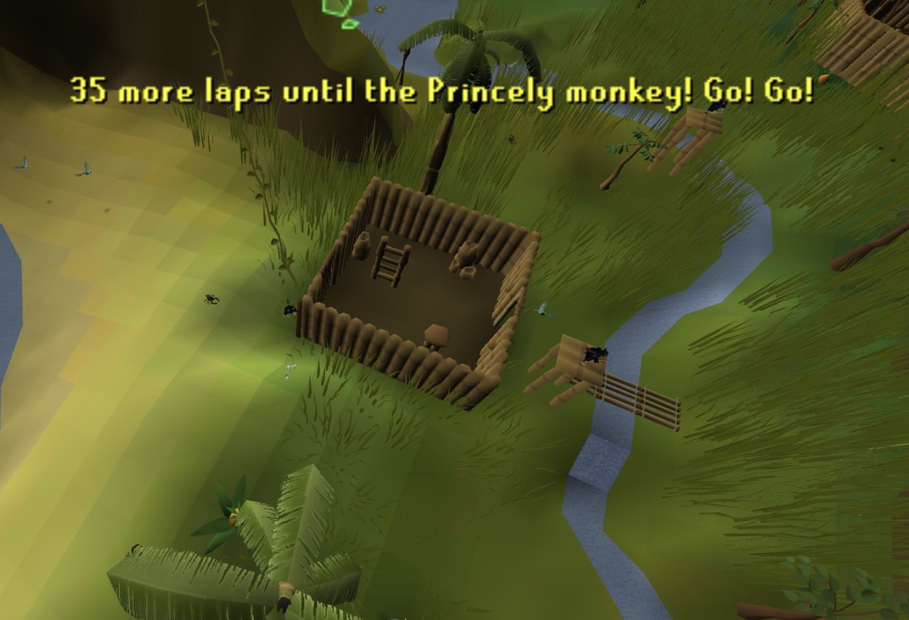

# Ape Atoll Encouragement

Bobawu cheers you on after each lap of the Ape Atoll agility course to spice up the grind

## Bobawu's dialogue

- **Countdown:** x more laps until the x monkey! Go! Go!”
- **Unlock:** “x unlocked! Ook!”
- **After 2,000 laps:** “x laps... Go home...”

Messages appear above Bobawu (monkey at the base of the agility course)

## Monkey backpack milestones

| Laps | Transformation |
| --- | --- |
| 100 | Karamjan monkey |
| 250 | Zombie monkey |
| 500 | Maniacal monkey |
| 1,000 | Skeleton monkey |
| 1,500 | Kruk jr |
| 2,000 | Princely monkey |

[Wiki page for milestones](https://oldschool.runescape.wiki/w/Ape_Atoll_Agility_Course#Monkey_backpacks)
