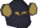

# Ape Atoll Encouragement



Bobawu cheers you on after each Ape Atoll Agility course lap, counting down to your next monkey backpack transformation.

- **Countdown:** “113 more laps until the Zombie monkey! Go! Go!”
- **Unlock:** “Zombie monkey unlocked! Ook!”
- **After 2,000 laps:** “2001 laps... Go home...”

Messages appear above Bobawu for approximately five seconds and are visible only in your client. Countdown messages use each monkey's name, including Kruk jr.

## Requirements and use

Enable **Ape Atoll Encouragement** in RuneLite and complete a lap with Bobawu loaded nearby. No configuration is needed.

The plugin reads the game's Ape Atoll lap-count chat message, so the total includes previously recorded laps. Game lap-count announcements must be enabled; speak to Grace if you have disabled them. Bobawu tracks backpack progress after Monkey Madness II. The plugin does not estimate progress from XP or session laps.

## Monkey milestones

| Laps | Transformation |
| --- | --- |
| 100 | Karamjan monkey |
| 250 | Zombie monkey |
| 500 | Maniacal monkey |
| 1,000 | Skeleton monkey |
| 1,500 | Kruk jr |
| 2,000 | Princely monkey |

[Official backpack unlock announcement](https://secure.runescape.com/m=news/grotesque-guardian-changes-and-monkey-backpacks?oldschool=1)

## Development

Requires JDK 11 or newer.

```sh
./gradlew run
```

This launches RuneLite in developer mode with the plugin loaded. Enable the plugin in the client. Restart the development client after changing source code.

```sh
./gradlew clean build
```

Builds the plugin and runs unit tests for lap-message parsing, countdown wording, and unlock milestones. `ApeAtollEncouragementPluginTest` is the development-client launcher.

## License

Plugin source is licensed under the [BSD 2-Clause License](LICENSE). RuneScape and the Bobawu game artwork belong to Jagex; the source license does not grant rights to that artwork.
